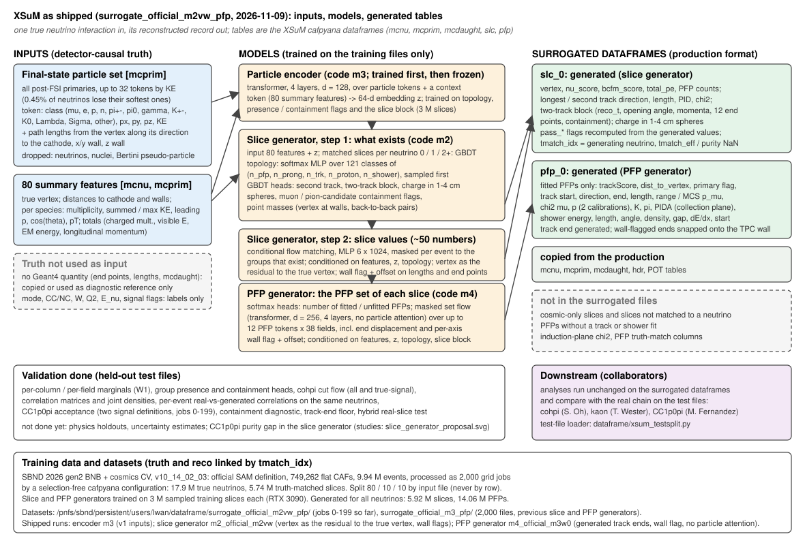

# XSuM: SBND sim→reco surrogate

An AI/ML surrogate for the SBND detector and reconstruction chain: a per-event stochastic map from GENIE
final-state truth (`mcnu`) to the reconstructed variables a cafpyana analysis uses (`evt`), trained on SBND
MC, built to forward-fold truth from models that were never simulated. Sister project of
[`opendata-sim2reco`](https://github.com/linyan-w/opendata-sim2reco) (MINERvA open data); same design, SBND
LArTPC data model.

Status: M0 (data audit, slimming, training table, file-level splits) on the cohpi example dataset. Read
[`docs/PROJECT.md`](docs/PROJECT.md) for the design and [`docs/dataset_notes.md`](docs/dataset_notes.md) for
what is in the example dataframe.

## Inputs and outputs



## Quick start

```
bash scripts/setup_env.sh                       # Python >= 3.9 venv: torch (CUDA), pandas, pytables, ...
source .venv/bin/activate
python scripts/slim_cohpi_df.py /path/to/cohpi_all_weight_signal_mc_no_dirz_cont_var.df data/cache
                                                # drop the 22k systematic-weight columns -> Parquet (seconds)
python scripts/dataset_summary.py data/cache    # rows, matching, efficiency, response quantiles
pytest -q                                       # loader and training-table tests (skipped without the cache)
```

## Layout

- `xsum/io/` — reading the cafpyana HDF5 dataframes, physics-column slimming.
- `xsum/prep/` — per-neutrino training table: truth + `selected` flag + Tier 1 reco block.
- `xsum/data/` — file-level splits; torch datasets (M1+).
- `xsum/models/`, `xsum/train/`, `xsum/eval/` — surrogate models, training loops, metrics (M1+).
- `configs/data.yaml` — source df, truth and reco column lists, split settings.
- `configs/cafpyana/analysis_village/xsum/` — cafpyana df-maker config for the full surrogate dataset (drop into a cafpyana checkout).
- `docs/` — project design, dataset notes.
- `scripts/` — environment, slimming, summaries.
- `tests/` — tests on the slimmed cache.

## Data

The example dataset is the cohpi analysis dataframe (SBND 2026 gen2 BNB + cosmics CV, v10_14_02_03) kept
outside the repository; nothing under `data/` is committed. Flat CAFs live on Fermilab dCache and are
processed with [cafpyana](https://github.com/sungbinoh/cafpyana).
